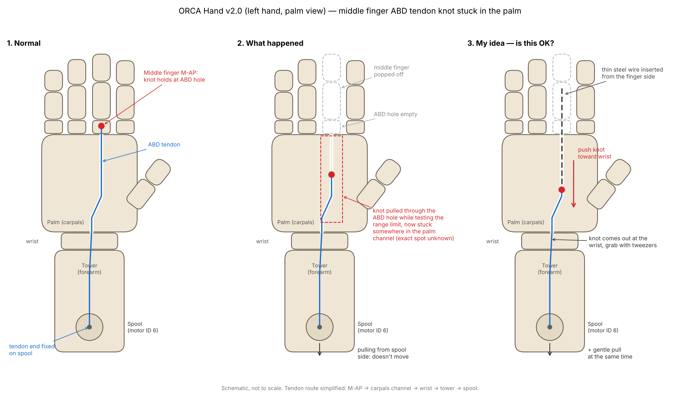

# 中指 ABD 腱绳的结脱出，卡进手掌通道（2026-10-29）

## 现象

- 硬件：ORCA Hand **v2.0 左手**（Dynamixel，通道里**没有 PTFE 管**），U2D2 + orca_core 测试。
- 小角度测试都正常。测**最大活动范围**时听到连续"嘎嘣"声，中指 ABD（外展）腱绳末端的结从 M-AP 的 ABD 孔里被拉出，掉进手掌（Carpals）通道。

## 当前状态

- 线轮那一端（中指 ABD = **6 号电机**）还固定着。
- 中指已弹下：结**不在**掌指交界处，在手掌通道更深的地方，具体位置不明。
- 从线轮侧轻拉，拉不动。为避免拉断或拉坏通道，没有继续用力。

## 原因分析（推测）

- orca_core 的 v2 左手配置（`models/v2/orcahand-left/config.yaml`）：
  - `control_mode: current_based_position`，即带电流上限的位置控制。
  - `max_current` 默认 300 mA（Dynamixel）。
  - `middle_abd` 软件活动范围是 −27°～+27°。
- 关节顶到机械极限后，电机会以上限电流一直拉住。v2.0 是裸 PLA 通道，摩擦大，这个力集中在结上，结就被一点点挤过了孔。
- 待确认：当时是否改过电流上限，以及用的是哪个脚本。

## 已排除

- **手掌不能打开。** v2 的 Carpals 是一整块打印件，内有 32 条通道；装配时是先穿线，再装手指。
- **从线轮侧硬拉不可取。** 这样会把结往更深的 Tower 通道里拖。

## 处理方案

1. **推 + 拉**（首选）
   - 从手指侧通道口插细钢丝，把结往手腕方向推，同时从线轮侧轻拉。
   - 结从手腕处出来后，用镊子夹出。
   - 剪掉压坏的那一截线头。
   - 用引线把线头从手指侧拉回 ABD 孔。
   - 打大结（必要时垫小珠子），在中立位重新张紧，然后重新校准。
2. **推不动时**
   - 在手腕处剪断这根线，把卡住的那一段推出来。
   - 照官方装配视频，单独更换这一根腱绳。
3. **顺便改进**：v2.1 在通道里加了 PTFE 管。这次修理时可以考虑给这条通道也加上。

## 预防

- 测极限时用官方 `calibrate.py`；手动测试时先调低电流，一边加大角度一边看 Present Current。
- 修好后，把 17 个关节的极限重新测一遍。
- 左手接普通转接器时，在配置里固定 `hardware_version: 2`。v2.0 和 v2.1 的拇指 MCP/DIP 方向相反。

## 外部求助

- ORCA Discord：https://discord.gg/xvGyxaccRa （来自官方硬件仓库 README）
- 已发帖询问取结方法，附上本页示意图。

## 参考

- 官方硬件仓库：https://github.com/orcahand/orcahand_hardware （`ASSEMBLY_ADDENDUM.md`：PTFE 管、引线技巧）
- orca_core：https://github.com/orcahand/orca_core
- v2 装配视频：https://www.youtube.com/watch?v=TgIz7HiyaoU （Carpals 穿线约在 25:05）
