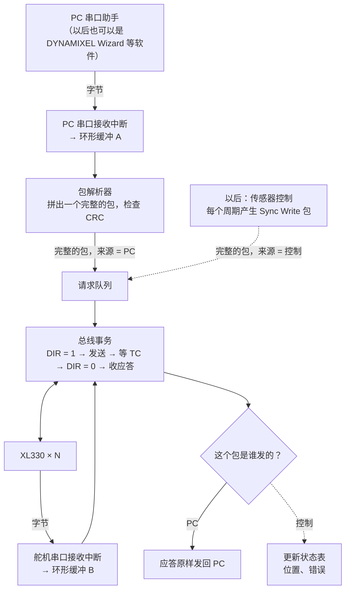
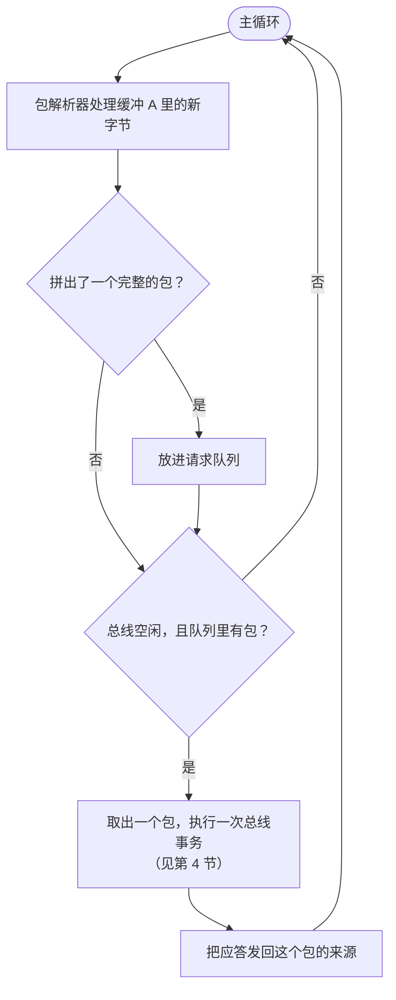
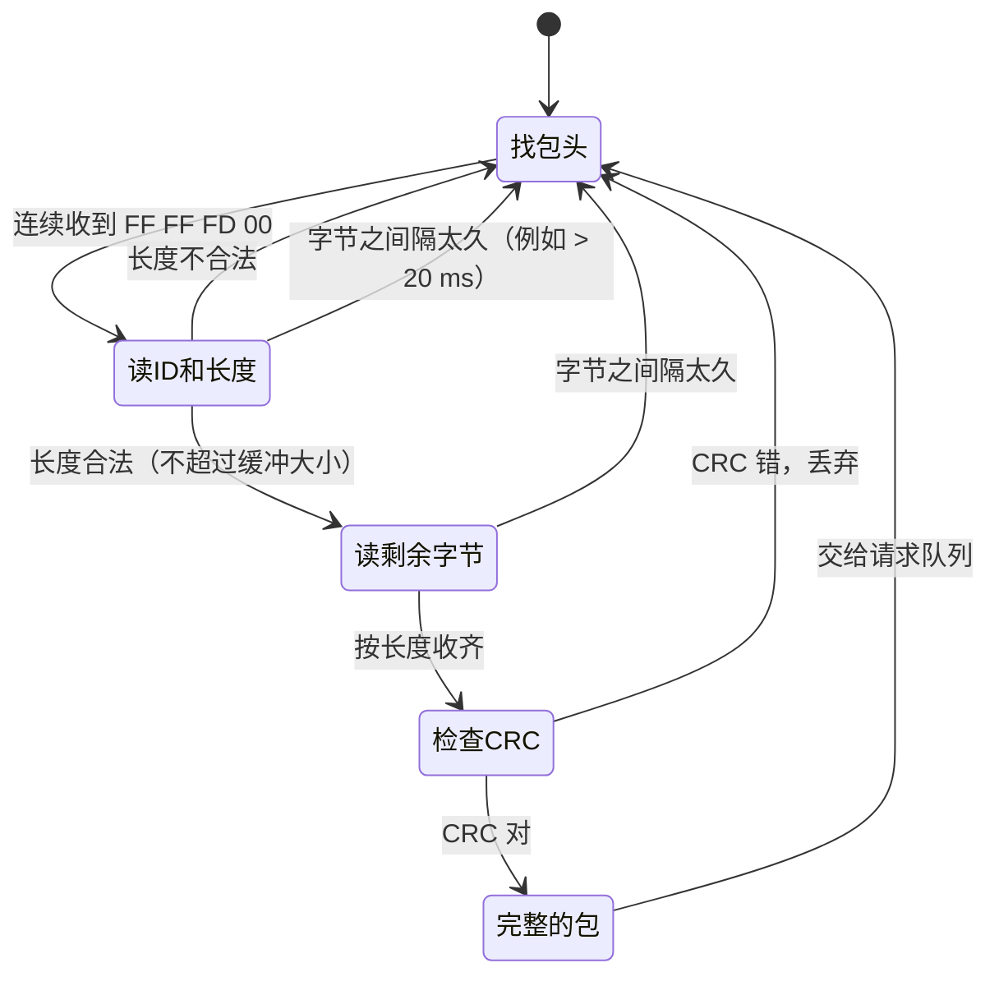
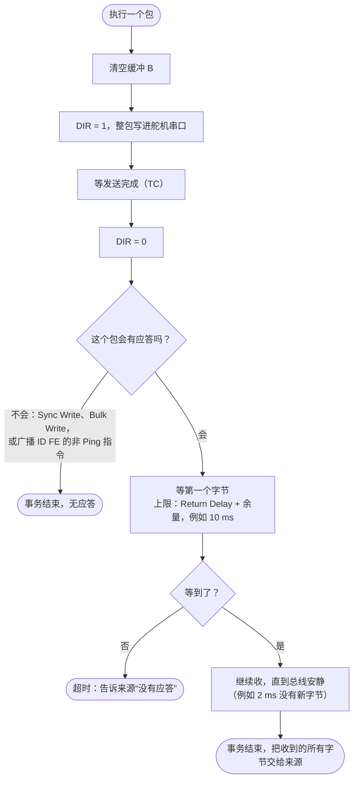
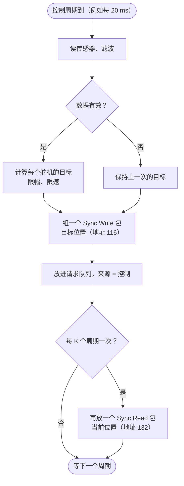

# 应用通信流程：PC 包转发（以后可接传感器）

按这份设计写好的代码在 `firmware/bridge/`（`bridge_main_template.c` 里填上 KM1M7C 的串口和 DIR 引脚就能用）。

现在的用法：PC 发一个 DYNAMIXEL 包给 MCU，MCU 转给舵机，再把舵机的应答转回 PC。以后要根据传感器数据自动发包时，只需要多加一个“指令来源”，下面的总线部分一行都不用改。

## 设计原则

1. **按“包”转发，不按“字节”转发。** MCU 先按 DYNAMIXEL 格式把 PC 的一个包收完整（包头 `FF FF FD 00` + 长度字段），再整包发给舵机。这样 MCU 确切知道包在哪里结束，发完马上切 DIR，不用靠“2 ms 没有新字节”去猜；还能检查 CRC，坏包直接丢掉，不发到总线上。
2. **指令来源和总线分开。** 来源只负责“产生一个完整的包”：现在是 PC，以后是传感器控制。总线层只负责“发一个包、收应答”。谁产生的包，应答就送回给谁。
3. **总线一次只做一件事。** 一个事务（发包 + 收完应答）结束，才开始下一个。事务进行中 PC 又发来新包，就先放进队列。
4. **中断只收字节。** 两个串口的接收中断只把字节放进各自的环形缓冲。解析、发送、切 DIR 都在主循环里做。
5. **每一步都有超时。** 收 PC 的包、等舵机应答都有时间上限，超时就回到初始状态，不会卡死。

## 1. 结构

虚线是以后加传感器时才有的部分。

## 2. 主循环

以后加传感器，只在主循环里多一个判断：“控制周期到了吗？到了就把这一周期的 Sync Write 包放进请求队列。”

## 3. 包解析器（收 PC 的包）

PC 的字节是陆续到的，解析器一个字节一个字节地往前走：

包的结构：`FF FF FD 00` | ID | 长度低 | 长度高 | 指令 | 参数… | CRC 低 | CRC 高。长度 = 指令 + 参数 + CRC 的字节数，所以读完长度字段后，再收“长度”个字节就是整个包。

## 4. 一次总线事务

用“收到总线安静为止”的方式，不用事先知道有几个应答：普通指令是 1 个应答，广播 Ping 和 Sync Read 是每个舵机各 1 个，全都会被收下来。

来源是 PC 时，超时就什么都不发回去（PC 那边自己会等不到应答）。不要往 PC 的串口里插入提示文字，否则以后用 DYNAMIXEL Wizard 这类软件时会被当成坏数据；调试信息走另一个串口或 LED。

| 指令 | 会有几个应答 |
|---|---|
| Ping、Read、Write（单个 ID） | 1 个 |
| Ping（广播 ID FE） | 每个舵机 1 个 |
| Sync Read 0x82、Bulk Read 0x92 | 包里列出的每个舵机 1 个 |
| Sync Write 0x83、Bulk Write 0x93 | 没有 |
| 其他指令发到广播 ID FE | 没有 |

## 5. 两个串口的速度

- **PC 一侧**（USB 虚拟串口）：和舵机一侧用同一个波特率最简单，例如都是 57600。
- **舵机一侧**：出厂 57600。以后要更快，再改成 1 Mbps（地址 8 写 3），PC 一侧也跟着改。
- 转发是**透明的**：MCU 不改包的内容，PC 收到的就是舵机原样的应答。做好以后，电脑上的 DYNAMIXEL Wizard 2.0 或 DynamixelSDK 也可以通过这个串口直接控制舵机（波特率要一致）。

## 6. 以后加传感器

传感器控制是第二个指令来源，按固定周期把包放进同一个请求队列：

PC 和控制同时有包时，按顺序一个个执行即可。如果要求控制周期很准，可以让控制的包排在 PC 的包前面。

每个周期总线要花的时间（Sync Write 写 4 字节 + Sync Read 读 4 字节，每字节 10 位）：

| 波特率 | 舵机数 | Sync Write | Sync Read | 合计 |
|---|---|---|---|---|
| 57600，Return Delay 500 µs（出厂） | 1 | 3.3 ms | 5.7 ms | 9.0 ms |
| 57600，Return Delay 500 µs | 3 | 5.0 ms | 12.3 ms | 17.3 ms |
| 1 Mbps，Return Delay 0 | 3 | 0.3 ms | 0.6 ms | 0.9 ms |

57600 下建议控制周期 20 ms，每周期写，每 5 个周期读一次。

## 用到的地址和指令（XL330，Protocol 2.0）

| 名称 | 地址 / 指令 | 说明 |
|---|---|---|
| Baud Rate | 8 | 1 = 57600，3 = 1 Mbps（EEPROM，扭矩关时才能写） |
| Return Delay Time | 9 | 单位 2 µs，出厂 250 = 500 µs（EEPROM） |
| Torque Enable | 64 | 1 = 开 |
| Hardware Error Status | 70 | 不为 0 就是硬件错误 |
| Goal Position | 116 | 4 字节 |
| Present Position | 132 | 4 字节 |
| Ping / Read / Write | 指令 0x01 / 0x02 / 0x03 | |
| Sync Read / Sync Write | 指令 0x82 / 0x83 | 一个包对多个舵机 |
| 应答包 | 指令 0x55 | 舵机回来的包 |
