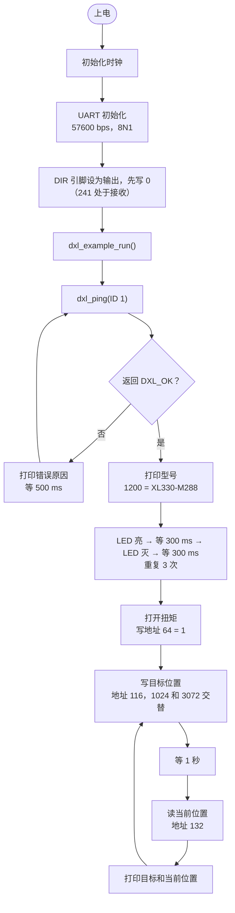
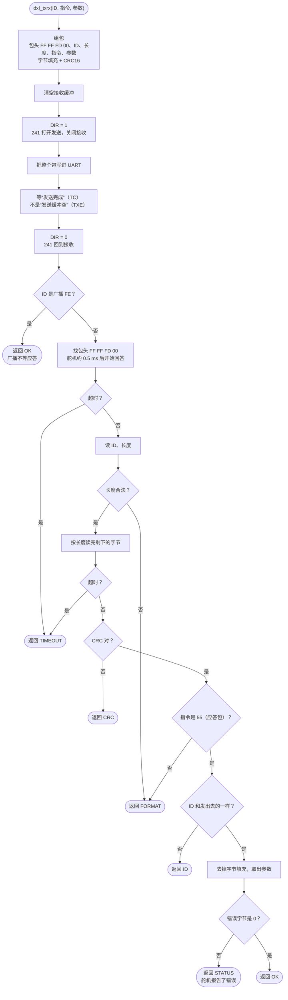
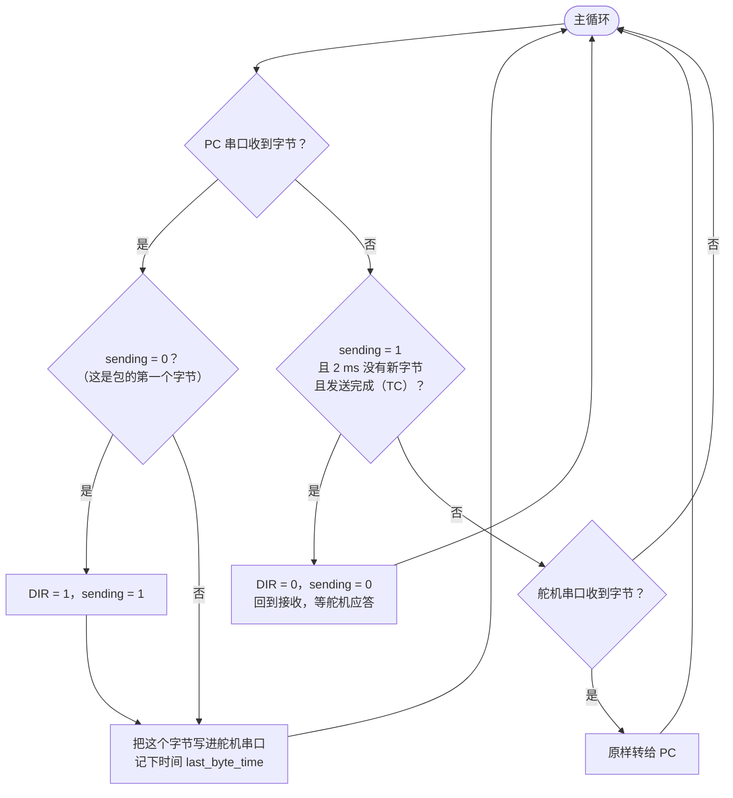

# 固件流程图

三张图：`main()` 整体怎么跑、一次收发（`dxl_txrx`）里面做了什么、以及你现在“PC 手动发、MCU 转发”的程序加上自动切 DIR 以后的样子。图里的函数名和 `firmware/dxl/` 里的代码一一对应。

## 1. main()：上电到舵机来回转

`main()` 做完初始化后调用 `dxl_example_run()`（`dxl_example.c`）。

## 2. 一次收发：dxl_txrx()

`dxl_ping`、`dxl_set_led`、`dxl_set_goal_position`、`dxl_get_present_position` 最后都走这个函数（`dxl.c`）。DIR 的切换就在这里。

返回值：`DXL_OK` = 0，`TIMEOUT` = -1，`CRC` = -2，`ID` = -3，`STATUS` = -4，`FORMAT` = -6。

## 3. 你现在的程序：PC 手动发，MCU 转发（加上自动切 DIR）

PC 串口助手用 HEX 发一个包，MCU 把它转给舵机，再把舵机的应答转回 PC。手动切 DIR 来不及收应答（舵机约 0.5 ms 就回答），所以要按下面这样由程序自动切。对应 `docs/breadboard/快速检查.md` 的 4.3。

